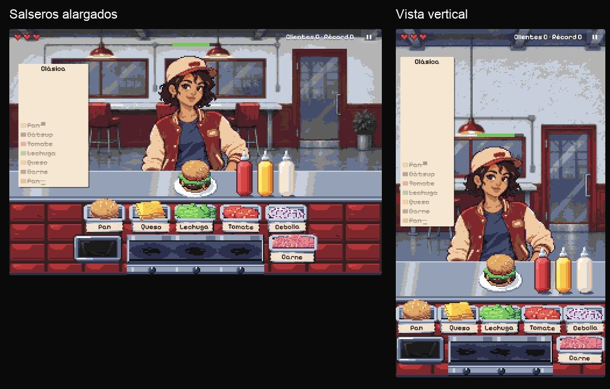

# Revisiones visuales del minijuego

Las carpetas conservan referencias, propuestas, fuentes de revisión y capturas realizadas durante el desarrollo. Las propuestas descartadas sirven como historial y no describen el aspecto actual. La producción se regenera desde `scripts/sprites/`, sin depender de este archivo de revisiones.

## Resultado aprobado · 3 de noviembre de 2026

| Revisión | Qué documenta |
| --- | --- |
| [UI arcade y cocción compacta](ui-review-2026-11-03/README.md) | Marcador central, comanda con reloj y checklist, cocción segmentada; implementación y capturas reales |
| [Salseros finales](sauce-dispensers-2026-11-03/README.md) | Cuerpo alargado de 16 × 42, tapa baja y boquilla fina; capturas de ambas composiciones |
| [Acero vigente](matched-steel-2026-11-03/README.md) | Reflejos estrechos y tonos acordes con puerta y plancha |
| [Conjunto de preparación](balanced-prep-2026-11-03/README.md) | Plancha centrada, basura y carne de 42 × 25 a la misma altura |
| [Tres quemadores](steel-three-burners-2026-11-03/README.md) | Tres lugares activos desde el inicio, perillas redondas y comprobación con tres carnes |
| [Espacio del plato](mobile-worktop-2026-11-03/README.md) | Plato de 38 × 22 y barra ampliada en ambas composiciones |
| [Materiales de cocina](kitchen-detail-2026-11-03/README.md) | Texturas de alimentos y superficies acordes con los clientes |
| [Entorno y Endesga-64](endesga64-unified-2026-11-03/README.md) | Rediseño del comedor y normalización de todos los colores |
| [Clientes nativos](customers-native-96x120-2026-11-03/README.md) | Doce personajes, proporciones revisadas y perfiles alternados |

La bolsa interior texturizada se documenta en [bright-steel-liner](bright-steel-liner-2026-11-03/README.md); su tratamiento de la encimera fue sustituido por el de acero vigente. La versión corta de los salseros queda en [sauces-volume](sauces-volume-2026-11-03/README.md) y fue sustituida por los salseros finales.

El resultado usa exclusivamente Endesga-64 y una única escala entera de píxeles. Las páginas `/clientes-prueba` y `/sprites` muestran los recursos reales, solo durante el desarrollo. Las capturas son referencias de revisión y no se cargan en la landing.

