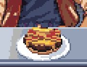
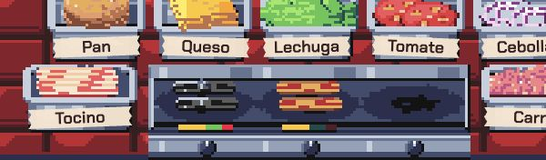
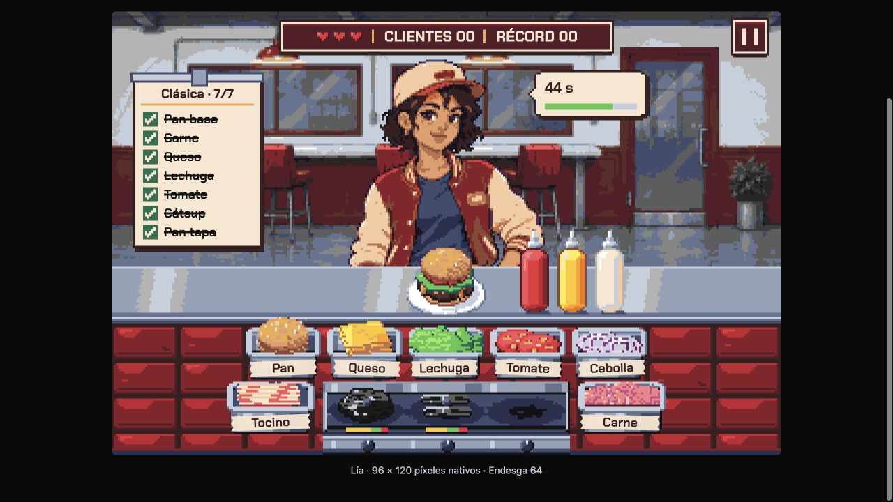

# Tocino en la plancha

Bandeja izquierda en lugar de la basura. Cocción de 2 s; carne de 3 s. Espacios compartidos, barras específicas por duración y retirada directa de los ingredientes quemados. Recetas con tocino desde el segundo nivel.

- [Escritorio](tocino-desktop.png)
- [Móvil](tocino-mobile.png)

Verificación funcional: carne y tocino colocados juntos; tocino listo a los 2 s y carne todavía cocinándose; carne lista a los 3 s; ambos colocados en el orden correcto de la comanda. Pruebas automatizadas cubren quemado, descarte, recetas, rechazo de ingrediente incorrecto y cálculo de paciencia.

Validación final: 184 pruebas y compilación correctas; sin errores de consola durante la revisión de escritorio y disposición móvil.

## Revisión del sprite

Dos tiras sueltas y cruzadas con siluetas diferentes, franjas de grasa, pliegues y sombras de contacto en la plancha y la hamburguesa. La bandeja presenta un bloque ordenado de rebanadas superpuestas. Se conservan las dimensiones, las anclas y los tiempos de cocción.

- [Detalle: hamburguesa, bandeja y plancha](tocino-rebanadas.png)
- [Escritorio](tocino-rebanadas-desktop.png)
- [Móvil](tocino-rebanadas-mobile.png)

## Tiras separadas en plancha y bandeja renovada

`tocino_plancha` presenta dos tiras sin solapamiento, con un hueco entre ambas. La hamburguesa conserva las dos tiras cruzadas. Bandeja redibujada como bloque con vetas de grasa onduladas y canto sombreado.

- [Detalle](tocino-separado.png)
- [Móvil](tocino-separado-mobile.png)

## Opción D implementada

Vetas anchas y claras, carne coral y grasa dorada al cocinarse. Dos tiras separadas en plancha y cruzadas en hamburguesa; bandeja con bloque de rebanadas. Se conserva la cuadrícula nativa de 26 × 13 y la bandeja de 42 × 25. Verificado en escritorio y disposición móvil; 193 pruebas y compilación correctas.

- [Detalle de la opción D](tocino-opcion-d.png)
- [Móvil](tocino-opcion-d-mobile.png)

## Centrado sobre la hamburguesa

Ancla del tocino ajustada de [13,11] a [13,6]: las tiras se apoyan en el centro de la superficie, cinco píxeles nativos hacia delante. Verificado en escritorio y móvil; compilación correcta.

## Tocino quemado visible

Más contraste mediante ceniza en los bordes superiores y tonos grises en la grasa carbonizada. Comprobados ambos estados junto a tocino listo, encaje en móvil y retirada directa.

## Colores de quemado compartidos

Carne y tocino comparten carbón, negro y grises de ceniza. Verificados juntos en la plancha; se conserva cada silueta.

