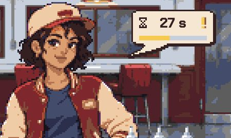
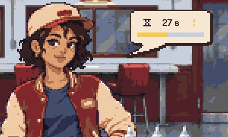
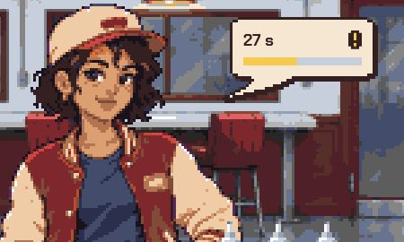
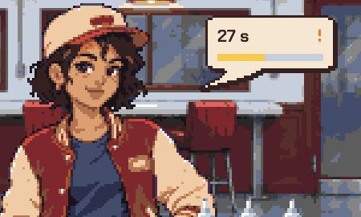
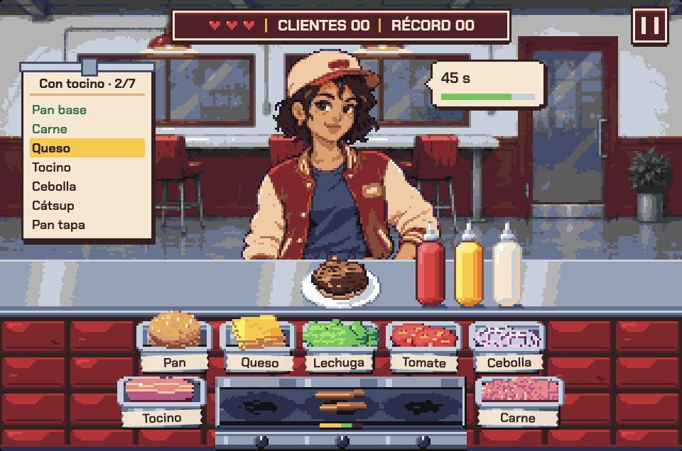
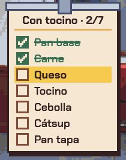

# Propuestas de UI · 3 de noviembre de 2026

Propuestas conceptuales originales y registro de la implementación de la opción seleccionada. Conservan como referencia el comedor, clientes, ingredientes y cocina aprobados. Las imágenes generativas ilustran dirección, jerarquía y distribución; no son capturas de una implementación ni una validación exacta de píxeles o paleta.

## Selección acordada

El usuario eligió el **marcador arcade** y, para la cocción, la **opción A: línea segmentada compacta**, en sustitución de los diales grandes de la propuesta inicial.

- Marcador superior centrado con vidas, clientes atendidos y récord; pausa independiente en la esquina superior derecha, según la última revisión.
- Comanda de papel compacta solo con receta, avance y pasos en orden de armado; reloj, barra de paciencia y emoji en un globo junto al cliente (última revisión).
- Una línea segmentada debajo de cada carne, dentro de la plancha y sin aumentar su altura ni cubrir las perillas; amarillo al cocinar, verde con ✓ cuando está lista y rojo con ! cuando hay que retirarla.
- La implementación deberá distinguir también carne quemada y lugar vacío.

Referencia seleccionada: [cocción compacta, opción A](04-coccion-compacta.png). B y C quedan como alternativas descartadas. Generada con `image_gen`; prompt en [prompt-coccion-compacta.txt](prompt-coccion-compacta.txt). **Selección de diseño aprobada e implementada.**

## Hallazgos en el proyecto

| Antes | Propuesta | Motivo |
| --- | --- | --- |
| Vidas a la izquierda, puntuación a la derecha y pausa fuera del HUD | Una unidad central con vidas, clientes atendidos, récord y pausa | Facilitar su localización y dar un soporte legible sobre el comedor |
| Barra de paciencia sin etiqueta ni icono, separada de la comanda | Reloj y tiempo restante dentro de la unidad cliente/comanda | Aclarar qué tiempo se está agotando y distinguirlo de vidas y cocción |
| Comanda de altura fija, filas pegadas abajo y lectura inversa al armado | Comanda compacta con lectura natural, ingredientes reconocibles, pasos completados y siguiente paso destacado | Reducir espacio vacío y el esfuerzo de interpretar la receta |
| Cocción con pista de tres colores y relleno superpuesto de tres píxeles lógicos de alto | Señales por quemador con progreso, estado y símbolo explícitos | Evitar que el color sea la única señal y distinguir cocinar, retirar y quemado |

Inspección: `src/game/view/game-view.ts`, `src/game/layouts/index.ts`, `src/components/MiniGame.astro`, `src/game/game/grill.ts`, recetas y documentación de arte vigente. También se abrió el juego local y se inició una partida. Referencia visual: captura horizontal de `sauce-dispensers-2026-11-03` y su comparación horizontal/vertical.

## Direcciones

1. **[Marcador arcade](01-marcador-arcade.png):** HUD superior centrado; comanda corta en papel a la izquierda con reloj; cocción mediante diales pixelados. Conserva la distribución actual con una intervención moderada.
2. **[Consola de mostrador](02-consola-mostrador.png):** HUD integrado en el frente del mostrador; comanda en bocadillo con secuencia de ingredientes; indicadores segmentados en el frente de la plancha. Mayor integración con el restaurante; exige ampliar el frente del mostrador.
3. **[Panel central de turno](03-panel-turno.png):** panel superior centrado que agrupa HUD, comanda y paciencia; señales breves junto a cada carne. Máxima concentración de información; exige reservar espacio para que el panel no tape al cliente.

En todas las opciones, el estado de cada carne permanece vinculado a su quemador. Centralizar estos estados lejos de la plancha aumentaría el recorrido de la mirada y dificultaría identificar qué carne retirar.

## Criterios para implementar la opción elegida

- Mantener una escala entera de píxeles y verificar todos los colores con Endesga-64; la generación de imágenes no garantiza esta precisión.
- Usar solo datos existentes: vidas, atendidos, récord, pausa, paciencia, receta y estado de cada carne. Los valores de las propuestas son ilustrativos.
- Mostrar cocinando, lista, aviso, quemada y lugar vacío con símbolos o textos además del color. No confundir lista con progreso incompleto.
- Mantener la relación espacial de cada indicador con su carne y evitar tapar la carne o las perillas.
- En la comanda, distinguir pan base, pan intermedio y tapa; conservar repeticiones en recetas de varias carnes y panes. La Clásica de las imágenes es un ejemplo; habrá que comprobar La torre y Tres panes.
- Dimensionar la unidad de pausa para tacto y conservar acceso por teclado, foco visible y nombre accesible.
- Adaptar la composición vertical, sin limitarse a reducir la horizontal; comprobar cara del cliente, receta larga, tres carnes simultáneas y hamburguesa alta.
- Mantener quietos los indicadores ordinarios; reservar avisos visuales para cambios útiles y respetar movimiento reducido.

## Implementación y verificación

Aplicado en `MiniGame.astro`, `game-view.ts` y los layouts. Se conserva el arte existente; no se incorporan las imágenes generativas al juego. El marcador reúne vidas, clientes y récord; pausa queda independiente en la esquina superior derecha; se dispone en una sola fila en ambas orientaciones. Pausa tiene 44 × 44 px a escala 2×. La comanda crece según la receta, se lee de arriba hacia abajo y muestra el reloj, avance, casillas y siguiente paso. El tutorial se actualiza a esta lectura. La cocción usa cinco segmentos de dos celdas de alto, con ✓ / ! / ×; solo el aviso parpadea, y se detiene con movimiento reducido.

Comprobado en navegador: tutorial completo y entrega, pausa/reanudación por botón y teclado, reloj detenido durante pausa, tres carnes simultáneas, cocción, lista, aviso, quemada y descarte; comandas de once y doce ingredientes sin desbordamiento y sin tapar el rostro. Capturas reales: [escritorio](implementado-desktop.png) y [móvil](implementado-mobile.png). La vista móvil se revisó a 390 × 844; también se revisaron anchos de 360 y 768. El teléfono físico sigue pendiente.

Las 161 pruebas y la compilación pasan. Las pruebas de clientes ahora comprueban que el marcador y la comanda dejan libres los rostros y que el marcador queda centrado, en lugar de buscar la antigua barra de paciencia.

## Generación

Herramienta integrada `image_gen`, con una solicitud independiente por dirección y la captura existente como referencia. Los prompts completos están en [prompts.json](prompts.json). Metodología: Luxury Pages del proyecto; criterios complementarios de UI/UX Pro Max y Emil Design Engineering; generación conforme a ImageGen.

## Refinamiento del marcador

Se reduce la altura del panel de 22 a 14 celdas en horizontal y de 30 a 16 en vertical. El marcador móvil pasa a una sola fila; la zona táctil de pausa conserva 22 × 22 celdas (44 × 44 px a escala 2×), centrada sobre el soporte compacto. Hover, pulsación y foco afectan únicamente al icono; el área táctil permanece transparente.

Capturas actualizadas: [escritorio compacto](compacto-desktop.png) y [móvil compacto](compacto-mobile.png). Comprobado a 360 × 800 sin desbordamiento del marcador y con pausa de 44 × 44 px; pausa por botón y reanudación por teclado correctas. Compilación y 161 pruebas correctas. El hover se verificó en las reglas CSS; el navegador de revisión no reprodujo el estado hover durante la captura.

### Pausa sin borde y centrado vertical

Se retira el borde del icono y se mantiene un fondo burdeos con dos barras claras. La zona táctil se centra mediante `top: 50%` y `translateY(-50%)`, para evitar el desfase que introducía el borde del marcador al usar coordenadas verticales fijas. Se midió una diferencia de 0 px entre los centros del panel, el botón y el icono tanto en horizontal como en vertical; la zona táctil móvil conserva 44 × 44 px. Compilación correcta. [Detalle real del resultado](pausa-sin-borde.png).

### Pausa independiente · decisión vigente

Pausa se separa del marcador y pasa a la esquina superior derecha del escenario. El panel central contiene únicamente corazones, clientes y récord; se reduce su anchura y se centra el contenido con relleno simétrico. Se conserva el botón de pausa sin borde, con fondo burdeos y área táctil de 44 × 44 px a escala 2×. El icono se alinea verticalmente con el centro del marcador en ambas orientaciones, sin solaparse con él. Esta decisión sustituye su ubicación dentro del marcador descrita en las revisiones anteriores. Captura real: [marcador y pausa independiente](pausa-independiente.png).

### Estilo compartido de las dos islas · acabado vigente

El botón de pausa independiente utiliza exactamente el mismo fondo, borde crema, contorno oscuro, reflejo interior y sombra que el marcador central mediante una regla CSS compartida. Su superficie visible mide 14 celdas en horizontal y 16 en vertical, igual que el marcador en cada orientación, con ambos bordes alineados. Se conserva la zona táctil de 22 × 22 celdas y el feedback limitado a la superficie visible. Esta revisión sustituye el acabado anterior sin borde. Captura real: [islas alineadas](islas-alineadas.png).

### Globo de paciencia del cliente · revisión vigente

El tiempo se retira de la comanda y pasa a un globo junto al rostro, con barra de paciencia y emoji: 🙂 tranquilo, 😐 impaciente al bajar del 60 % y 😠 enojado al bajar del 30 %. Al entregar muestra 😄 y «¡Gracias!»; si se va por tiempo, 😠 y «Sin tiempo». En el tutorial dice «Sin prisa» y la barra permanece completa. No se modifica la lógica ni los tiempos del juego.

La comanda conserva únicamente nombre, avance y lista de ingredientes, con altura ajustada al contenido y diez celdas menos de encabezado. El globo usa posiciones propias en horizontal y vertical; se reubica la guía del tutorial para que ambos globos convivan sin tapar el rostro. La barra expone su valor a lectores de pantalla; el estado del ánimo también se expresa en texto accesible. Los emojis son sprites nativos pixel art de 12 × 12 en Endesga-64, con cuatro variantes de ánimo; no se usan glifos del sistema. La barra reutiliza los mismos cinco segmentos, separación, altura, fondo y sombra de los indicadores de cocción, ampliando únicamente el ancho de cada segmento para el globo.

Capturas reales: [escritorio](globo-cliente-desktop.png) y [móvil](globo-cliente-mobile.png).

Corrección de arte del globo: caritas nativas `animo:tranquilo`, `animo:impaciente`, `animo:enojado` y `animo:feliz`, incorporadas al atlas existente; 164 pruebas correctas (incluidas validación, estilo y rasterización del nuevo sprite) y compilación correcta.

### Cuadrícula del globo y zonas permanentes de cocción · acabado vigente

El globo pasa a ser una silueta nativa del atlas: esquinas redondeadas mediante escalones ortogonales y cola con celdas enteras, sin diagonales suavizadas. Cuerpo y cola comparten el mismo contorno continuo. El emoji se fija a una columna de 12 celdas para que el ancho del contador no lo desplace a posiciones fraccionarias.

La barra del globo conserva sus cinco segmentos dentro de un marco metálico de 48 × 6 celdas: canto superior claro, lateral gris, bisel inferior oscuro y fondo azul acero. Todo usa Endesga-64 y unidades enteras de la cuadrícula; la tipografía conserva su escala propia.

Se restaura la lectura de cocción solicitada: las zonas amarilla, verde y roja permanecen visibles y cada segmento se ilumina al alcanzar su tiempo; no se recolorea toda la barra de verde. Los símbolos ✓ / ! / × permanecen. Con la configuración actual son tres segmentos amarillos, uno verde y uno rojo; el reparto se adapta a la configuración conservando las tres zonas y sus transiciones reales.

173 pruebas correctas y compilación correcta; incluyen los nuevos fondos de globo y límites de encendido de las zonas de cocción. Capturas reales: [escritorio](globo-pixel-marco-desktop.png) y [móvil](globo-pixel-marco-mobile.png).

### Barras continuas y caritas planas · 4 de noviembre de 2026

Ambas barras pasan a ser continuas. Cocción conserva las tres zonas amarillo/verde/rojo en posiciones fijas calculadas con sus duraciones; una capa iluminada avanza por ellas sin recolorear toda la barra. Se conservan los símbolos de lista, aviso y quemada. Paciencia usa un relleno continuo dentro del marco metálico, manteniendo los cambios de color del ánimo.

Las caritas siguen midiendo 12 × 12, pero eliminan contorno y sombreado. El fondo amarillo plano (ámbar al enojarse) contrasta con ojos y boca negros de mayor tamaño. Se mantienen las cuatro expresiones y la cuadrícula nativa.

173 pruebas y compilación correctas. Capturas reales de esta revisión: [escritorio](barras-continuas-desktop.png) y [móvil](barras-continuas-mobile.png). Las pruebas del indicador comprueban ahora límites de zona y avance continuo, incluidos tiempos configurables y saturación al inicio/final.

### Caritas ampliadas sin barra · 4 de noviembre de 2026 · estado vigente

Se retira completamente la barra de paciencia del globo, incluido su marco. Solo se muestran el contador y la carita. Las cuatro expresiones se redibujan a 24 × 24 celdas, el doble de tamaño nativo, con ojos, cejas, párpados, mejillas y bocas diferenciadas. No llevan contorno oscuro ni sombras oscuras que confundan los rasgos. Los ojos y la boca contrastan con un rostro amarillo; los detalles claros y cálidos pertenecen a Endesga-64.

El globo se adapta a esta expresión, conservando sus esquinas escalonadas y la cola nativa: 66 × 35 horizontal y 68 × 37 vertical, incluida la cola. Se mantiene la barra continua de cocción con sus tres zonas.

173 pruebas y compilación correctas. Capturas reales: [escritorio](caritas-detalladas-desktop.png) y [móvil](caritas-detalladas-mobile.png). Esta revisión sustituye la barra de paciencia y las caritas pequeñas de las revisiones anteriores.

### Solo contador y barra · 4 de noviembre de 2026 · estado vigente

Se retiran las caritas del globo y del atlas de producción. El globo compacto conserva solo contador y barra continua de paciencia con marco metálico; cambia de verde a ámbar y rojo según el tiempo restante. Se mantienen el contador sin límite del tutorial y los mensajes de salida. Cuerpo, cola y marco se alinean a la cuadrícula; las esquinas redondeadas siguen siendo escalonadas. La barra de cocción conserva sus tres zonas continuas.

173 pruebas previas; con la retirada del sprite de ánimo quedan 170 pruebas, todas correctas, más compilación correcta. Capturas de la revisión: [escritorio](solo-contador-barra-desktop.png) y [móvil](solo-contador-barra-mobile.png). Esta decisión sustituye todas las variantes anteriores con caritas.

### Barra de espera sin marco · 4 de noviembre de 2026

Se retiran borde, bisel, relleno y sombra metálicos de la barra de espera. Queda una pista continua de tres celdas de alto con fondo gris claro, relleno verde/ámbar/rojo y el contador encima. El espaciado conserva la alineación a celdas enteras. No se añade nuevo contenido al globo; las frases de ánimo quedan como propuesta pendiente. Captura real: [detalle de la barra sin marco](barra-espera-sin-marco.png).

### Frases variadas por estado · 4 de noviembre de 2026

Se incorporan seis frases para cada estado: tranquilo, impaciente, enojado y feliz (24 en total). Cada estado usa una bolsa barajada que se agota antes de repetir; al reiniciar la bolsa se evita repetir la última frase. La selección se conserva por cliente y estado durante el reloj, la pausa, el cambio de orientación y las interacciones. Si un cliente vuelve a un estado ya visitado, recupera su frase anterior.

Las frases se integran entre contador y barra sin aumentar el tamaño del globo ni agregar caras. `customer-dialogue.ts` concentra el repertorio y la selección. Las pruebas comprueban estabilidad, variedad, ausencia de repetición inmediata y continuidad durante la salida del cliente. 174 pruebas y compilación correctas. Capturas reales: [escritorio](frases-cliente-desktop.png) y [móvil](frases-cliente-mobile.png).

### Frases retiradas y cola inferior izquierda · 4 de noviembre de 2026

Se retiran las frases aleatorias y su selector. El globo vuelve a contener solo contador y barra continua sin marco. La cola sale ahora de la esquina inferior izquierda y apunta diagonalmente abajo a la izquierda hacia el cliente, sobresaliendo seis columnas del cuerpo en lugar de apuntar hacia abajo desde su base. Se conserva el cuerpo en su posición anterior y el dibujo nativo en la cuadrícula.

El número del pedido se propone como alternativa de contenido, pendiente de selección; todavía no se añade al globo. Captura real: [cola inferior izquierda](globo-cola-izquierda.png).

## Vista previa: miniatura del pedido

Propuesta visual aislada con los sprites reales: hamburguesa completa a la izquierda del contador y la barra. En móvil, miniatura arriba y tiempo debajo. Conserva la cola inferior izquierda y la cuadrícula de píxeles. No aplicada al juego.

- [Vista completa](miniatura-pedido-desktop.png)
- [Detalle del globo](miniatura-pedido-detalle.png)
- [Vista móvil](miniatura-pedido-mobile.png)

## Chakra Petch aplicada

Sustituye Pixelify Sans y las excepciones monoespaciadas del minijuego. Revisada en escritorio y móvil de 360 px sin desbordamientos en marcador, comanda ni etiquetas; compilación correcta.

- [Escritorio](chakra-petch-desktop.png)
- [Móvil](chakra-petch-mobile.png)

## Globo con reloj y atención

Cola más ancha y curvada, reloj de arena a la izquierda y señal de paciencia a la derecha. Marca verde, exclamación amarilla e interrogación roja parpadeante. Sin parpadeo con movimiento reducido. La página de clientes permite revisar los tres estados.

- [Tranquilo](globo-reloj-tranquilo.png)
- [Aviso](globo-reloj-aviso.png)
- [Urgente](globo-reloj-urgente.png)
- [Móvil](globo-reloj-mobile.png)

## Ajuste: reloj minimalista y alerta única

Reloj monocromo de 7 × 7, a la altura de los dígitos. Se retiran las señales verde y amarilla y la interrogación: solo aparece una exclamación roja parpadeante con menos del 30 % de paciencia. Comprobados los tres estados y el encaje móvil.

## Proporciones y dos ritmos de alerta

Reloj más estrecho (5 × 7), exclamación fina (2 × 7) y ambos centrados junto al contador. Amarillo: ciclo de 1.6 s; rojo: 0.6 s. Sin señal en verde. Verificado en escritorio y móvil.

## Contador con tipografía unificada

Contador a 6 × escala y peso 600, igual que las etiquetas. Reloj 5 × 5, exclamación de un solo píxel de grosor y sin sombra. Fila de ancho fijo centrada, sin cambios de posición entre estados. Se conservan los ciclos de 1.6 s y 0.6 s. Verificado en escritorio y móvil sin desbordamientos.

## Contador a la izquierda, sin reloj

Se retira el reloj. El contador se alinea con el inicio de la barra y el signo con su extremo derecho. La exclamación amarilla tiene una pequeña placa oscura pixelada, sin sombra; conserva el parpadeo lento y el rojo mantiene el rápido. Revisado en escritorio y móvil.

## Signo recuperado sin placa

Contador ampliado de 6 a 7 × escala, a la izquierda. Exclamación de 1 × 5 a la derecha sin fondo, sombra ni contorno. Ámbar oscuro para mejorar contraste en el estado intermedio (1.6 s); rojo urgente (0.6 s). Verificado en escritorio y móvil.

## Comanda y cocción sin checks ni equis

Se retiran los checks, las casillas de la comanda y las equis de cocción. El progreso de la comanda usa color verde y resaltado amarillo. Barras centradas; solo se conserva la alerta pixelada durante el aviso previo al quemado. Verificado en escritorio y disposición móvil.

## Checkboxes pixelados y tachado

Comanda con casillas del atlas y checks dibujados píxel a píxel. Ingredientes completados en verde y tachados; siguiente ingrediente resaltado. Versión compacta de la casilla para recetas largas. Las barras de cocción siguen sin checks ni equis.

